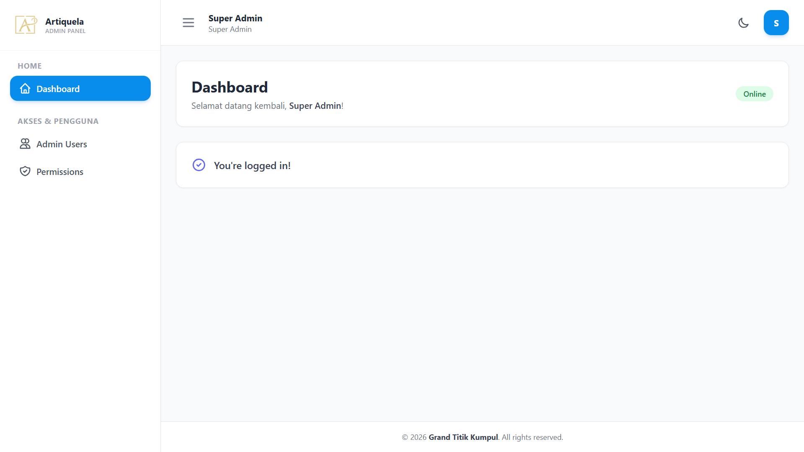

<p align="center">
  
</p>

<h1 align="center">Personal Admin Template Boilerplate</h1>

<p align="center">
  A clean, modern, and lightweight Laravel-based admin boilerplate built for fast development and easy customization.
</p>

---

##  Overview

This repository serves as a **personal admin template boilerplate** designed to kickstart new web application projects without setting up repetitive authentication, role management, and UI layouts from scratch.

It comes pre-configured with a custom-built admin dashboard theme, integrated role and permission management, and essential user management CRUD features.

---

##  Features

- **Custom Built Admin UI**: Clean, responsive layout crafted for high usability and seamless user experience.
- **Role & Permission Management**: Integrated with `spatie/laravel-permission` for robust Access Control List (ACL) management.
- **User CRUD**: Full User Management capabilities (Create, Read, Update, Delete) with assigned roles.
- **Permission CRUD**: Dedicated interface to manage dynamic application roles and granular permissions.
- **Modern Asset Workflow**: Ready to build using modern frontend tools like Bun or Node/NPM.

---

##  Tech Stack & Requirements

- **PHP**: ^8.x
- **Framework**: Laravel
- **Package Manager**: [Composer](https://getcomposer.org/) & [Bun](https://bun.sh/) (or [NPM](https://www.npmjs.com/))
- **Role Management**: Spatie Laravel Permission

---

##  Installation & Setup

Follow these simple steps to get your application up and running locally:

### 1. Clone the Repository
```bash
git clone https://github.com/your-username/your-repo-name.git
cd your-repo-name
```

### 2. Install PHP Dependencies
Run Composer to download and install all required PHP packages:
```bash
composer update
```

### 3. Setup Environment File
Copy the `.env.example` file to create your `.env` file, then update your database credentials and configuration:
```bash
cp .env.example .env
php artisan key:generate
```

### 4. Install Frontend Dependencies
Install and build asset dependencies using **Bun** (recommended) or **NPM**:

**Using Bun:**
```bash
bun install
bun run dev
```

**Using NPM:**
```bash
npm install
npm run dev
```

### 5. Run Database Migrations & Seeders
Execute the database migrations and seed default roles/permissions (if available):
```bash
php artisan migrate --seed
```

### 6. Serve the Application
Start the local development server:
```bash
php artisan serve
```

---

##  Preview

Here is a glimpse of the custom admin dashboard layout in action:

<p align="center">
  
</p>

---

##  License

This project is open-source software licensed under the [MIT License](LICENSE).
